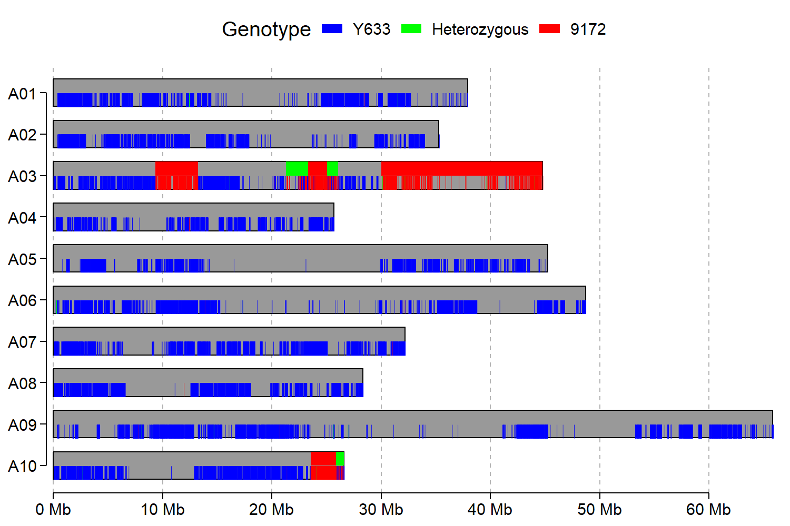

# BCIntrog

BCIntrog（Back-Cross Introgression）是一个用于植物回交育种群体的 R 包。它从全基因组重测序 VCF 中筛选亲本特异性标记，使用三状态隐马尔可夫模型（HMM）推断后代基因型，并鉴定供体亲本来源的基因组导入片段。

## 主要功能

- 读取 VCF/VCF.GZ，提取 CHROM、POS、REF、ALT、GT、GQ。
- 筛选双亲基因型相反纯合的双等位标记（SNP 和 indel 均可）。
- 按亲本 GQ 过滤低质量位点（默认 `GQ > 20`）。
- 将后代基因型编码为 D（供体纯合）、R（轮回亲本纯合）、H（杂合）或 `NA`。
- 基于物理距离的三状态 HMM，支持 Viterbi 和 Forward-Backward。
- 识别 D/R/H/Uninformative 片段，处理小于 `min_length` 的小片段。
- 统计供体基因组当量和轮回亲本背景恢复率。
- 绘制全基因组标记和片段分布图。

## 安装

```r
# 安装
devtools::install_github("laowang1992/BCIntrog")
```

## 快速开始

```r
library(BCIntrog)

# 读取 VCF 文件
vcf <- system.file("extdata", "Demo.vcf.gz", package = "BCIntrog")
dat <- read_vcf(vcf)

# 筛选亲本特异性标记并判定后代基因型
sites <- select_site(
  dat,
  donor = "9172",       # "9172" 为供体亲本名称
  recurrent = "Y633",   # "Y633" 为轮回亲本名称
  offspring = "WS100",  # "WS100" 为后代名称
  GQ = 20
)

# 基于 HMM 推断的遗传状态识别基因组片段
seg <- segment_detection(
  sites,
  min_length = 650000,     # 最小片段长度
  cross_length = 10000000  # 状态转换间的期望距离
)
summary(seg)

# 可视化
p <- visualization(seg, 
                   chr = c("scaffoldA01", "scaffoldA02", "scaffoldA03", "scaffoldA04", "scaffoldA05", 
                           "scaffoldA06", "scaffoldA07", "scaffoldA08", "scaffoldA09", "scaffoldA10"), # 要展示的染色体
                   label = c("A01", "A02", "A03", "A04", "A05", "A06", "A07", "A08", "A09", "A10"))    # 所选染色体的标签
p
```

也可以一键运行：

```r
res <- run_analysis(
  vcf,
  donor = "9172",
  recurrent = "Y633",
  offspring = "WS100"
)
summary(res$segments)
res$plot
```



## 输入要求

- VCF 必须包含 `GT`，`GQ` 可选。如果 VCF 完全缺少 GQ，会给出 WARNING 并跳过 GQ 过滤。
- 亲本应为高度纯合二倍体；只保留双亲基因型相反纯合的双等位标记。
- 支持多染色体和 contig。默认按 VCF 中首次出现顺序处理。
- 演示数据位于 `data/Demo.vcf.gz`；包内 `inst/extdata/Demo.vcf.gz` 用于示例。

## 输出约定

- 片段使用 **1-based 闭区间** `[Start, End]`。
- 相邻片段不重叠：后一段 `Start = 前一段 End + 1`。
- 片段长度 `Length_bp = End - Start + 1`；所有片段长度之和等于染色体长度。
- `Viterbi` 列取值为 D/R/H/NA；`State` 列为供体名、轮回亲本名、`Heterozygous` 或 `Uninformative`。
- `segments` 表包含 `CHROM`、`segment_id`、`Start`、`End`、`Length_bp`、`SNP_number`、`Observed_SNP_number`、`Viterbi` 和 `State`。
- 统计分母为纳入分析的染色体总长度 `L_total`：
  - `donor_genome_equivalent = (L_D + 0.5 * L_H) / L_total`
  - `recurrent_recovery_allelic = (L_R + 0.5 * L_H) / L_total`

## 注意事项

- 自定义发射矩阵必须是 3×3，且每行和为 1；行和不等于 1 会报错，不会自动归一化。
- 若某条染色体没有任何可用的后代基因型，会输出 `Uninformative` 片段
  （`Viterbi = NA`），不会强行判定为 D/R/H。

## 作者与许可

- 作者：Wang Pengfei
- 邮箱：wangpf0608@126.com
- License：GPL-3
