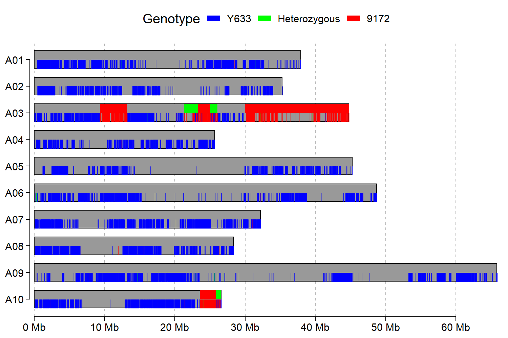

# BCIntrog

BCIntrog (Back-Cross Introgression) is an R package for identifying donor-parent-derived genomic segments in plant backcross breeding populations. It screens parental informative markers from whole-genome resequencing VCF data, infers offspring genotypes with a three-state hidden Markov model (HMM), and detects introgressed donor segments.

## Features

- Read VCF/VCF.GZ and extract CHROM, POS, REF, ALT, GT and GQ.
- Select biallelic markers where the donor and recurrent parents are homozygous for opposite alleles (SNPs and indels are both allowed).
- Filter low-quality markers by parental GQ (default `GQ > 20`).
- Call offspring genotypes as D (donor homozygous), R (recurrent homozygous), H (heterozygous) or `NA`.
- Run a three-state HMM with physical-distance transition probabilities; supports Viterbi and Forward-Backward.
- Detect D/R/H/Uninformative segments and process segments shorter than `min_length`.
- Summarize donor genome equivalents and recurrent parent background recovery.
- Generate genome-wide marker and segment plots.

## Installation

```r
# Install
devtools::install_github("laowang1992/BCIntrog")
```

## Quick start

```r
library(BCIntrog)

# read vcf file
vcf <- system.file("extdata", "Demo.vcf.gz", package = "BCIntrog")
dat <- read_vcf(vcf)

# select informative parental markers and call offspring genotypes
sites <- select_site(
  dat,
  donor = "9172",       # "9172" is the name of donor parent
  recurrent = "Y633",   # "Y633" is the name of recurrent parent
  offspring = "WS100",  # "WS100" is the name of offspring
  GQ = 20
)

# identify genomic segments from HMM-inferred genetic states
seg <- segment_detection(
  sites,
  min_length = 650000,     # minimum segment length 
  cross_length = 10000000  # expected distance between state changes
)
summary(seg)

# visualization
p <- visualization(seg, 
                   chr = c("scaffoldA01", "scaffoldA02", "scaffoldA03", "scaffoldA04", "scaffoldA05", 
                           "scaffoldA06", "scaffoldA07", "scaffoldA08", "scaffoldA09", "scaffoldA10"), # selected chromosome to display
                   label = c("A01", "A02", "A03", "A04", "A05", "A06", "A07", "A08", "A09", "A10"))    # label of selected chromosome
p
```

Or run the complete pipeline:

```r
res <- run_analysis(
  vcf,
  donor = "9172",
  recurrent = "Y633",
  offspring = "WS100"
)
summary(res$segments)
res$plot
```



## Input requirements

- The VCF must contain `GT`, `GQ` is optional. If GQ is completely absent, a WARNING is issued and GQ filtering is skipped.
- Parents should be highly homozygous diploids; only biallelic markers with opposite homozygous parental genotypes are retained.
- Multiple chromosomes and contigs are supported. The default order follows the first appearance in the VCF.
- Demo data are in `data/Demo.vcf.gz`; the package includes `inst/extdata/Demo.vcf.gz` for examples.

## Output conventions

- Segments use **1-based closed intervals** `[Start, End]`.
- Adjacent segments do not overlap: `Start[i + 1] = End[i] + 1`.
- `Length_bp = End - Start + 1`; the sum of segment lengths equals the chromosome length.
- `Viterbi` is D/R/H/NA; `State` is the donor name, recurrent name, `Heterozygous` or `Uninformative`.
- The `segments` table contains `CHROM`, `segment_id`, `Start`, `End`, `Length_bp`, `SNP_number`, `Observed_SNP_number`, `Viterbi` and `State`.
- The denominator is the total chromosome length `L_total`:
  - `donor_genome_equivalent = (L_D + 0.5 * L_H) / L_total`
  - `recurrent_recovery_allelic = (L_R + 0.5 * L_H) / L_total`

## Notes

- User-supplied emission matrices must be 3 x 3 and each row must sum to 1; matrices with rows not summing to 1 are rejected and are not automatically normalized.
- Chromosomes with no observed offspring genotypes are reported as `Uninformative` segments (`Viterbi = NA`); they are not forced into D/R/H.

## Author and license

- Author: Wang Pengfei
- Email: wangpf0608@126.com
- License: GPL-3
